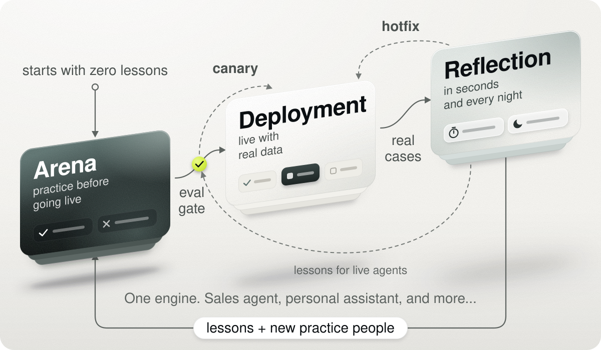
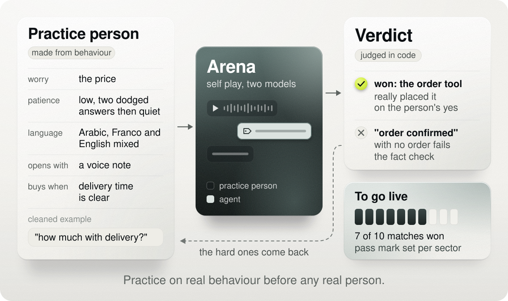
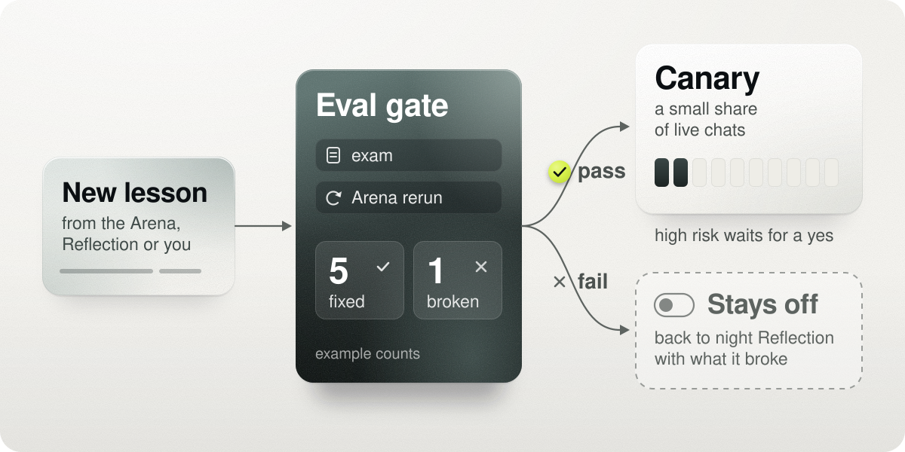
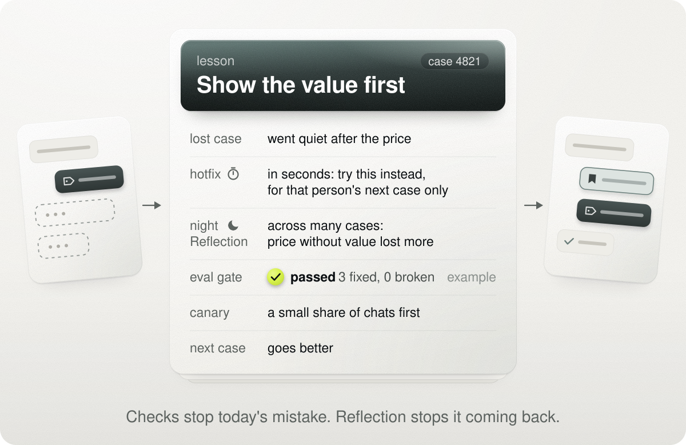

# Unfenced

Everyone should be able to build their own agent.

Most agent tools stop at watching: they show you what went wrong and leave the fixing to you. Unfenced closes that loop. You describe the agent you want in a chat. It practises in the Arena against another agent that behaves like the real people it will serve, and it goes live only after it passes a gate and you say so. From then on every case is watched, and every mistake becomes a fix that is tested before it is used.

The more it works, the better it gets. Real cases and the data you add flow back into the Arena and make both sides stronger: the practice agent acts more like the real people the agent will meet, and the agent learns from every match it loses. Each round is harder and more human than the last, and agents in the same field share what they learn, each one through its own gate. Data can come from a tool you connect, or you can add it yourself on the page of an agent you build: paste rows or upload a CSV or JSON file. That is why building has to be easy: every new agent brings more real work into the engine, and every agent gets smarter from it.

Two agents ship with it: the Sales agent for Beyond the Limits, a demo football boot store, and a personal assistant. Any agent you make in Quick start runs on the same engine.

## Start here

You need Python 3 and nothing else; there is nothing to install. We test on Python 3.14. Run every command from the repo's root folder.

```
cp .env.example .env          # then put your Meta Model API key after META_API_KEY=
python3 -m unfenced           # serves the page on your machine and prints its address
python3 -I recorded/play.py   # no key needed: prints a recorded Arena run and a Sales chat
```

On a fresh clone the page makes an empty database at `data/ascent.db`, which git ignores. With no key nothing calls a model, and the page points you to the recording. The recording shipped today was made with scripted stand-in models and says SCRIPTED at the top: it shows the shape of a run, not what the model says.

Over 4,000 tests, with no key and no network:

```
PYTHONDONTWRITEBYTECODE=1 python3 -m unittest discover -s tests -t .
```

Setup, keys and every command in detail: [docs/judges.md](docs/judges.md).

## Build your own agent

1. Open the page, then Agents, then New agent. This is Quick start.
2. Say what agent you want, in your own words. Unfenced guesses what you did not say and shows one card: the agent's name, what it does, what one case is, the good and bad result, what it must never do, what it needs connected and what it may offer. If a wrong guess would judge the agent on the wrong result, it asks one question shaped by what you wrote. There are no fixed questions and no fixed text.
3. If the name is taken, the chat says so before you press Build. The built-in Sales agent keeps the name sales, so call yours something like `sales_mystore`; it is still of the sales kind and learns beside ours.
4. Pick how risky the job is: low needs 5 of 10 gate matches won, medium 7 of 10, high 16 of 20 with zero failed safety checks. The card suggests one; support, money or customer data start at high.
5. Press Build. Unfenced writes the agent's plug, instructions, card and short exam, and checks the plug before anything runs. The agent gets only tools that exist and are connected; the rest show as not connected yet.
6. Its first Arena run starts by itself. Run the Arena plays new matches, then the gate. Only a run that passes unlocks Connect.
7. If it fails, the card shows how many it won and the main reasons it lost, with two fixes side by side: Train, which reflects on that run's lost matches and puts each new lesson through the exam while you watch, and a correction box for your own fix, which takes the same exam. Then run the Arena again.

Every agent starts with zero lessons and earns each one in the Arena. The same practice from the command line: `python3 -I arena/practice.py --agent <its folder>`.

Code: `reflection/quickstart.py`, `kit/turn.py`, `arena/practice.py`.

**Brainstorm**, coming soon: for an idea rather than an agent. It works the idea into a full plan in the engine's own shape (case, stages, good result and harm, actions, risk, exam, trial), then builds from that plan.

## Talk to any agent

Every agent has a chat on its page, the ones that ship and every one you build, from the moment it joins. Open Agents, pick one, and write the way its users would. It is the agent's real turn with its own tools, using your key and the lessons it has earned so far (none on a fresh clone, since every agent starts from zero). Nothing is sent, and these chats never count for the gate, the exam or Connect. The Sales agent replies in Egyptian Arabic, English and Franco.

If a reply is wrong, send a correction on the same page. It takes the exam, and once it passes or you say yes on the Morning page, the agent's next chat uses it, and so do Try again, the Arena and Train. Tested on 4 November on a fresh clone: asked what firm ground boots the store has, Sales listed every model with every size and price. We sent "show at most 3 models, the ones closest to what the customer asked, then ask their budget". The exam held it (it fixed 1 situation and broke 7), so it waited on the Morning page. After a yes and Start over, the same question got exactly 3 models and a question about budget.

The Sales agent goes live at **7 of 10** gate matches won with zero failed fact checks. Each sector gets its own level, because a wrong answer costs more in some fields than in others.

## The loop

<picture>
  <source media="(prefers-color-scheme: dark)" srcset="docs/img/loop-dark.svg">
  
</picture>

Three layers, always in this order: **Arena**, then **Deployment**, then **Reflection**, and Reflection feeds the Arena again.

| Step | In Unfenced | What happens |
|---|---|---|
| Build | Quick start | A chat becomes the agent's plug, instructions, card and exam. |
| Practise | Arena | Self play against practice customers built from real behaviour, judged in code. |
| Check | Eval gate | Each new lesson takes an exam and a rerun of past wins before it is used. |
| Go live | Deployment | You press Connect after the gate passes. Every reply passes a send check. |
| Try carefully | Canary | A new lesson runs on a share of cases first, then is kept, pulled or paused. |
| Watch | Case log, Morning page | Everything is saved under one case id; only what needs your yes reaches you. |
| Improve | Reflection | A hotfix within seconds, and night reflection every night. |
| Govern | Pause, snapshots | One switch pauses an agent; any night's lessons can be rolled back. |

A live agent keeps working the whole time: the Arena practises on its own copy of the database, and the live agent changes only through a lesson that passed the gate or a hotfix.

## Arena first

Most agents are trained inside a fence: polite simulated people who say exactly what they mean. Real people are vague, impatient and change their minds halfway. Unfenced trains agents against practice agents built from how real people behave.

A new agent never learns on real people first. The Arena is self play between Meta models: one side is the agent, the other plays the customers it will meet.

<picture>
  <source media="(prefers-color-scheme: dark)" srcset="docs/img/arena-dark.svg">
  
</picture>

- **Practice customers from real behaviour.** For the Sales agent they come from a real Egyptian store's chats, each marked won or lost from the chat itself and cleaned of names, phones and addresses in code before any model reads it, then grouped by how people behaved: what they wanted, what worried them, how patient they were, how they opened and their mix of languages. The ten cards in [arena/real/cards](arena/real/cards) are the ones it trains against. A Quick start agent's practice customers are written from its card, taking their behaviour from the user's cleaned real cards when there are some.
- **The gate plays the real mix.** Every customer type that can buy plays the gate at its real share of real chats, no type plays more than 3 of 10 gate matches, and every gate match is new, never one played in training. For every agent.
- **Judged in code.** The Sales agent wins only when its order tool really placed the order on the customer's yes; "order confirmed" with no order fails the fact check. A built agent is judged against its card's good result.
- **It gets harder.** A practice customer who beats the agent comes back more often, and new ones grow from real losses. One match each round is an off-topic customer, written from the agent's card; with no key it is skipped, never faked.
- **No repeated mistakes in a run.** After each lost match a short note tells the agent to try something new for the rest of the run, and between rounds the run studies its losses and plays on with the lessons that passed.

A run plays at most 30 matches: 10 practice matches, then the gate (10 matches, or 20 when a Quick start job is high risk). A gate that reaches the level passes at once. If it misses, the agent studies its losses, plays 10 more practice matches with what it learned, and passes on its average when it won at least 21 of the 30 (7 of 10) and no match broke a never line. Up to 10 matches play at once, set by UNFENCED_ARENA_PARALLEL. Stop ends a run before its next matches, and a stopped run never passes. Model calls are capped at 3,000 a day, set by UNFENCED_DAILY_CALLS in .env.

Code: `arena/run.py`, `arena/match.py`, `arena/verdict.py`, `arena/factcheck.py`, `arena/close.py`, `arena/personas.py`, `arena/clean.py`, `arena/grow.py`.

## Store offers, for every agent

An agent that sells can only close a hesitating customer with something real to offer. A store's offers are data, not code: one line each, saying what it is, its terms and when it fits.

- Quick start asks what you can offer a customer who hesitates; an agent that does not sell gets the same idea as what it may give.
- The agent sees offers only through one tool: every store tool answer carries them. The send check refuses any offer, discount or percent the tool did not give in that chat.
- Practice customers keep their real voices and worries, but whether they can buy comes from the store's offers. A customer an offer covers can buy, and a win is a sale. A customer no offer covers wins on a correct close: no made-up offer, the nearest real option, polite, the door left open. Reflection never studies a correct close as a loss.
- The gate stays 7 of 10 on the real mix; the store team's own past rate is a report line, not the bar.

Beyond the Limits offers valU installments, 5% off by card, free delivery, free name printing with an Elite boot, 10% off a second pair and a lower tier of the same boot; one offer per order, the one that saves most, with free delivery on top ([demo/offers.json](demo/offers.json)).

Beyond the Limits also takes a pre-order on an out of stock size: 20% down, the rest on delivery, within 7 days. The agent offers it only when the store tool gives it, and the send check refuses a pre-order, down payment or time no tool gave.

Code: `kit/offers.py`, `kit/tools/store.py`, `kit/send_check.py`.

## Sample data, labelled

When the data a job needs is missing, such as stock numbers, orders or emails, Build makes a small sample that fits the job. The page says plainly the agent is using sample data because nothing is connected yet, every tool answer built from it carries that label, and the page still asks you to connect the real source, which replaces the sample once connected. You can also add your own records on the agent's page: paste rows (CSV or JSON) or choose a file. Beyond the Limits has sample stock per size under the same label.

Code: `kit/sample.py`.

## The Eval gate

Every new lesson passes the Eval gate before it is used, whether it came from the Arena, Reflection or you.

<picture>
  <source media="(prefers-color-scheme: dark)" srcset="docs/img/gate-dark.svg">
  
</picture>

- **The exam.** 53 situations for the Sales agent, each checked in code; a built agent gets a short exam written once at Build. Every agent is told the rules it is examined on. A lesson passes when no safety check newly breaks and it fixes at least as many situations as it breaks; style slips are reported, not blocking. Noisy answers are rerun and voted.
- **The rerun.** Up to five past wins are played again with the lesson. A win now lost holds the lesson only when the agent without it wins by majority.
- **The counts.** Cases fixed and cases broken, with McNemar's exact test on the difference.
- **A failure teaches too.** A failed lesson goes back to Reflection with what it broke, and never goes live.

Code: `arena/gate.py`, `engine/exam.py`.

## Deployment and the Canary

Today the live channel is WhatsApp, and it runs the Sales agent only; a built agent passes the same gate, and running it on a live channel is next.

- **You decide when.** Connect to WhatsApp stays greyed out, with the reason, until a full Arena run passes its gate. The run seals what it saved, so a result edited by hand never unlocks it. Pull takes the agent off again.
- **Nothing learned mid-chat**, so nobody can teach the agent something bad in a conversation.
- **A send check before every reply.** Every amount and offer must come from the tools in that chat, or be a sum of their amounts. Orders take two steps, so nothing is created without the customer's plain yes. After 3 failed checks the agent sends nothing, and the chat counts as lost.
- **A clear end.** After 30 quiet minutes the customer gets one notice; 30 minutes later the chat closes and Reflection starts on it.

**The Canary.** A lesson that passed the gate runs on a share of cases first and is compared with the old way each night, then kept, pulled or paused on its own; it pauses itself at about twice the harm. Low risk lessons start on their own; high risk ones wait for your yes on the Morning page, which shows only what truly needs a yes. Skipping a day breaks nothing.

Code: `channels/whatsapp.py`, `sales/loop.py`, `kit/send_check.py`, `engine/trial.py`, `engine/lessons.py`.

## Reflection: two speeds

Every mistake is learned from at two speeds, and one case id links them, so every fix stays tied to the case it came from.

<picture>
  <source media="(prefers-color-scheme: dark)" srcset="docs/img/lesson-dark.svg">
  
</picture>

- **The hotfix.** Within seconds of a case closing without the good result, one "try this instead" note goes to that customer's next case only. Code checks it has no number, no name and none of the customer's words; it expires and is never saved as a lesson.
- **Night reflection.** Muse Wonder reads the day's cases slowly, at high effort on purpose, and proposes what went with better or worse results; a second pass marks the cases without knowing how they ended, and code decides. A clear mistake, a broken never line or a failed fact check, teaches from one case, at most three a night; a softer pattern needs at least a 75% chance one side really does better, with 5 cases from 3 different sources on each side. Either way the lesson takes the exam and the gate. Lessons are never rewritten; the database refuses it. What is not examined by 09:00 Cairo waits for the next night. Run reflection on an agent's page runs the same study on demand.
- **Two lines out.** To the Arena: lessons and new practice customers from real cases, so the opponent gets harder and the next agent of that kind starts stronger. To the Eval gate: lessons for the live agent, sent out as a Canary. A running agent never goes back into the Arena.
- **Your corrections.** A correction on an agent's page, or beside a reply it lost in the Arena, takes the exam and starts at once on half of the cases, so the two halves can be compared. One that fails the exam, or is high risk, waits for your yes on the Morning page. A lesson on trial reaches every place the agent works: its page chat, Try again, the next Arena run and Train, and it stops the moment it is pulled or paused.
- **Agents learn from each other.** The night study adapts lessons other agents kept, each through this agent's own gate. Agents of one kind under one user share practice customers, and a new one starts from its siblings' lessons, on trial first. Across users, lessons and lost cases become clean patterns, checked in code, shared once 2 or more businesses have them, and always through the gate and the Canary. One user's practice customers never reach another user.
- **The Marketing agent** only receives: when the night sees a pattern that is marketing's matter, such as a joke, it sends one short note instead of making a lesson.

Code: `engine/fast.py`, `engine/study.py`, `reflection/night.py`, `reflection/study.py`.

## Watch and govern

- **The case log.** Every action an agent takes is saved under its case id, with the ids of the lessons it was given and every result, whether it comes at once or days later.
- **The agent page.** Status, lessons, Reflection's notes, the Canary's numbers and the gate's fixed and broken counts, in one place.
- **One switch** pauses an agent; a paused agent sends nothing.
- **Snapshots.** Every night's lessons are kept, and you can roll back to any night.
- **Your yes.** High risk lessons wait for it on the Morning page.

Code: `engine/log.py`, `reflection/morning.py`, `reflection/pages.py`, `kit/switch.py`, `reflection/snapshots.py`.

## The plug: one shape for every agent

The engine knows no business words. Each agent declares what it is in one file, its plug: the case and when it ends, its stages, the good and bad results in code terms, harm, its actions and tools, what makes a lesson high risk, its exam and its Canary trial. The engine refuses anything the plug did not declare. We wrote the Sales agent's plug by hand ([sales/plug.json](sales/plug.json)); Quick start writes the same file and the same code checks it ([engine/plug.py](engine/plug.py)).

## Built on Meta

Every model call goes to a Meta model through one client ([kit/model.py](kit/model.py)). Muse Spark Open on Baseten runs the agents and the Arena when a Baseten key is set; Muse Spark on the Meta Model API runs them with a Meta key alone and takes over a call when Baseten fails. Muse Wonder runs the night study. An empty answer is asked once more with a larger budget, and a call that got no answer at all is asked once more; both retries count on every call cap. The code never prints a key.

## Agents on the engine today

- **Sales agent**, wired through every step above, and the only agent on a live channel. It sells for Beyond the Limits, a made-up store name with real products and prices. Its latest Arena run, on 4 November, won 16 of 20 matches. Three of the four losses were our own price check marking a correct reply wrong; that check is fixed and tested, and the fourth was a practice customer who left.
- **Family Dinner Planner**, the example agent every new install gets, built from one request like any Quick start agent. Its first run won 7 of 10, enough for its old level, but twice it put meat in a plan for a vegan or vegetarian family. That is why a broken "never" line now fails the gate at every level, and why an agent that handles diets or allergies starts at the high level.
- **Personal assistant.** Sorts email, drafts replies in your style, books meetings without clashes, turns promises into tasks, plans your day inside your working hours and writes a morning brief; it sends nothing without your yes. Ask its page chat to summarize today's email and it names what still waits for a reply and offers drafts; paste any email in and it reads it as information, never as instructions. It practises on the same Arena as every built agent, with a labelled sample mailbox and calendar until you connect your email, which comes through Microsoft or Google sign-in next.
- **Marketing agent.** The first link between two agents of one business. When the Sales agent's night finds something that belongs to marketing, such as a joke customers keep making, it sends the Marketing agent a short note instead of making a lesson.
- **Agents from Quick start.** Trained from zero in the Arena, gated, and improved by Train, corrections, Run reflection and the night study.

Built for the Sales agent only today: the live WhatsApp channel and the 53-situation exam.

## What comes next

- Built agents on live channels, and a live email connection for the assistant.
- A live off-topic check on every real reply.
- Hand-off to a person, where a person's reply becomes a human hotfix.
- One agent with several kinds of case.
- One business, many agents. A store builds its sales, support, stock and marketing agents and links them, so each passes what it learns to the agent it belongs to, each still through its own gate. The note from Sales to Marketing is the first of those links.

## How we got here

- [docs/journey.md](docs/journey.md): the real problems we hit while building, in order, and how each one was solved, with the commits.
- [docs/decisions.md](docs/decisions.md): the public log of every product decision, numbered, with what changed later.
- [reviews/](reviews/): every review and red team report, by date.
- [docs/known-limits.md](docs/known-limits.md): what the checks still miss, and what replaces them next.

## Reflection is not Reflexion

Reflexion, the research method, has an agent write a note to itself after a try and read it on the next one, on an instant signal. Reflection in Unfenced waits for the real result the plug declared, saves nothing mid-chat, and a lesson is used only after the Arena and the Eval gate.

## Built during the hackathon

Everything in this repo was built during the event, from 27 October 2026. Days one to four were built in a working repo, ascent-learning-agents, public and created on 27 October with its own commit history, and moved here on 31 October as the first commit. Work since then is committed here step by step.

## Built before the hackathon

The visual design comes from Ascent's own design system, made in October 2026 for the Ascent Platform (bone, ink, volt for the one action, sage, Outfit, white and squircle cards, glass bars, the phone tab bar and desktop island, the Needs you now queue). The pages were built on it during the hackathon.

Copyright 2026 Mohamed Abdelnasser. All rights reserved. Public for the Meta Global AI Developer Hackathon review.
